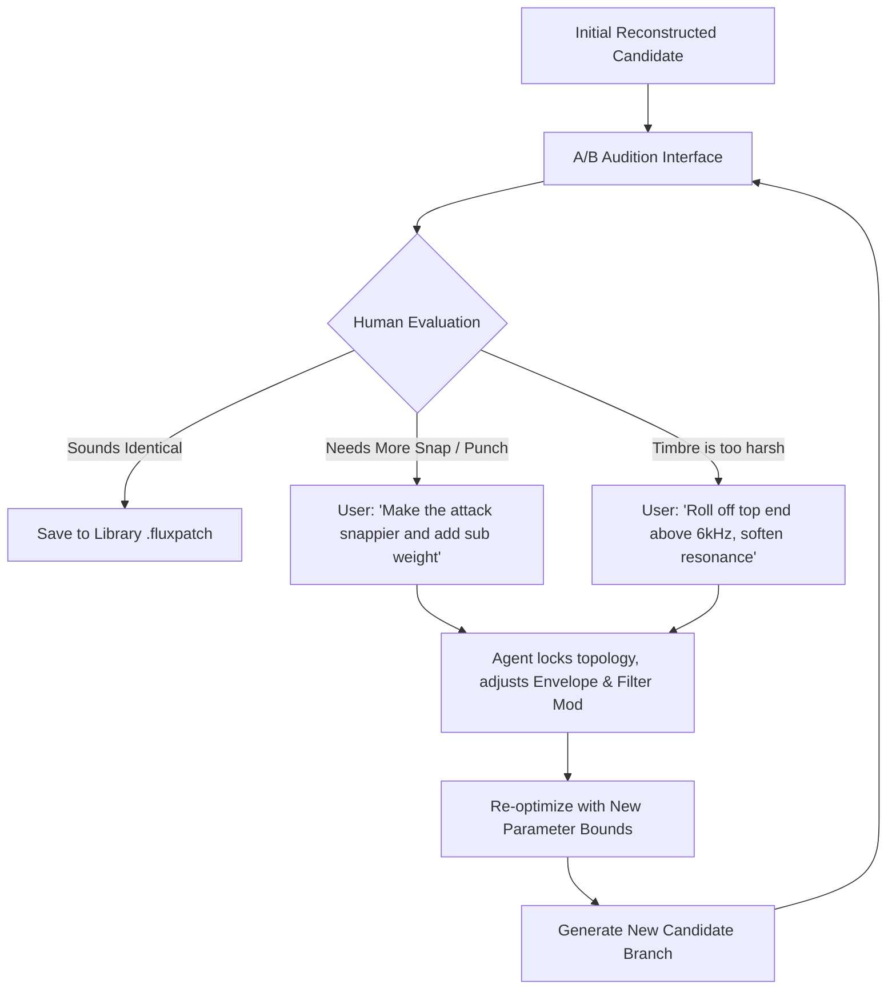
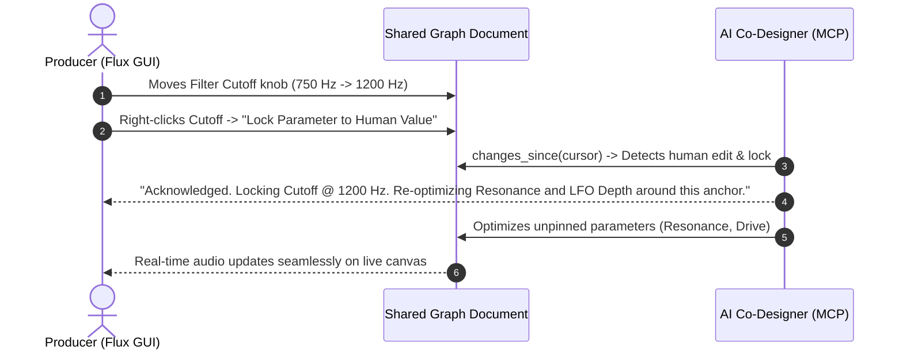
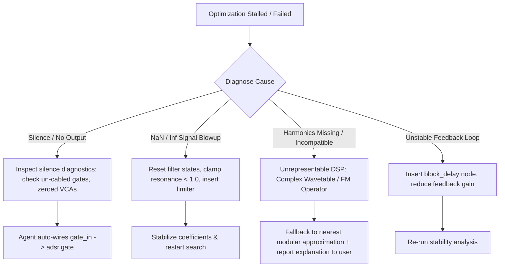

# AI Patch Reconstruction: Critical User Journeys & Workflow Design (Designer Track)

**Status:** proposal (gated on human review)  
**Date:** 2026-09-01  
**Author:** Sound Design & UI Track (Antigravity)  
**Related Docs:** [`AI_PATCH_RECONSTRUCTION_TECH.md`](AI_PATCH_RECONSTRUCTION_TECH.md) · [`AI_SAMPLER_MCP.md`](AI_SAMPLER_MCP.md) · [`STATE_TOOLS.md`](STATE_TOOLS.md) · [`ARCHITECTURE.md`](ARCHITECTURE.md) · `../flux/docs/design/AI-SYNTHESIS.md`

---

## 1. Vision & Core Philosophy

### 1.1 From Black Boxes to Open Modular Canvases
Commercial and proprietary synthesizers (Vital, Serum, Diva, Phase Plant, Arturia V-Collection, Dexed) are locked binary ecosystems. A sound designer who programs or discovers a compelling sound in a VST3/CLAP plugin is typically trapped:
1. **Opaque signal flow**: The internal DSP graph is uninspectable, hidden behind proprietary skins and compiled native code.
2. **Fixed architectures**: You cannot rewire a closed synth's filter into a feedback loop or insert custom waveshapers between arbitrary oscillators unless the original vendor anticipated that routing.
3. **Format decay & vendor lock-in**: Presets cannot be shared with collaborators who lack the specific commercial license or operating system support.

**The Vision:** The **AI Patch Reconstruction System** bridges **Nexus** (our universal CLAP/VST3 hosting environment) and **Simply Flux** (our open, real-time, modular DSP grid). By coupling offline audio feature analysis, intelligent topology synthesis, and parameter optimization over the Model Context Protocol (MCP), an AI sound design partner samples any target plugin patch in Nexus, extracts its acoustic and musical DNA, and reconstructs an open, fully-editable, transparent modular patch in Flux.

```
┌────────────────────────┐                   ┌────────────────────────┐
│      NEXUS HOST        │                   │       FLUX GRID        │
│  (Closed Plugin / VST) │                   │  (Open Modular Patch)  │
│  ┌──────────────────┐  │   Acoustic DNA    │  ┌──────────────────┐  │
│  │ Vital / Serum /  │  │ ────────────────> │  │ [Osc] ──> [SVF]  │  │
│  │ Diva / Dexed …   │  │   Reconstruction  │  │   ▲        │     │  │
│  └──────────────────┘  │       Bridge      │  │ [ADSR] ──> [VCA] │  │
│     Target Sound       │                   │  └──────────────────┘  │
└────────────────────────┘                   └────────────────────────┘
```

---

### 1.2 "The Medium is Oil, Not Watercolour"
Reconstruction is **not** a one-shot "text prompt to finished sound" translation. Following the sound design philosophy established in `flux/docs/design/AI-SYNTHESIS.md`:

> *"As I hear things and the AI suggests new ideas, that parks further things in me. It's like painting, where the initial shape is rough but you cover it up and refine along the way… A creative co-evolution between AI suggestions and the human suggesting changes."* (Chris)

1. **Co-Evolution & Zero-Cost Branching**: The goal of patch reconstruction is not merely an exact bit-for-bit duplicate; it is to discover an expressive, playable instrument. The human and AI share a live canvas with a unified undo/branching tree (`history`, `goto`, `undo`).
2. **Restraint & Wú Wéi (無為)**: The system does not brute-force optimize toward a single arbitrary loss number. Instead, it respects perceptual thresholds (Just Noticeable Differences, JNDs), enforces acoustic feasibility invariants, and presents an unranked spread of candidate topologies for the human to audition and steer.
3. **Playability Over Static Match**: A reconstructed patch must feel right under the musician's hands — knobs must have musical tapers, modulation inputs must respond to velocity and aftertouch, and envelopes must articulate naturally during real-time performance.

---

### 1.3 Ground Truth: AI Perception via Tools & Autonomous Exploration
A critical reality governs our entire AI sound design architecture:
- **LLMs Do Not Understand Musical Audio**: Audio AI models (even those with audio token inputs) understand audio primarily as **speech** and voice phonetics. They are blind to micro-timbral nuances like high-order saturation harmonics, all-pass phase dispersion, resonance Q, and subtle transient attack curvature.
- **Sensory Organs via Tools**: For an AI to perceive sound, it must be given **objective perceptual analysis tools** (multi-scale STFT, Hilbert envelope log-attack trackers, stiff-string inharmonicity estimators, SSM profiles). Crucially, the AI should be capable of **building and extending its own analysis tools** as new acoustic questions arise.
- **Beyond Reconstruction: Autonomous Patch Exploration**: Equipping the AI with perceptual tools enables not just recreating existing patches, but **autonomously exploring high-dimensional parameter spaces** to discover novel, acoustically rich, and musically compelling patch ideas.

---

## 2. User Personas

| Persona | Role & Background | Needs & Goals | Frustrations / Pain Points |
|---|---|---|---|
| **Alex (The Producer)** | Electronic & Pop Music Producer working in Ableton Live / Bitwig Studio. Uses Serum, Vital, and Diva daily. | • Quickly port a signature lead or bass patch into an open modular environment.<br>• Tweak filter macros and modulation depths without paying heavy CPU costs of legacy plugins.<br>• Keep sound design moving without breaking creative flow. | • Commercial plugins have high CPU footprints and opaque routing.<br>• Preset files (.fxp, .vital) cannot be inspected or automated modularly.<br>• AI tools that output static WAVs rather than tweakable synth patches. |
| **Elena (The Sound Designer)** | Game Audio & Film Sound Designer building bespoke sci-fi ambiences, UI sounds, and evolving textures. | • Deconstruct complex hybrid acoustic/electronic patches into reusable subgrids (`.fluxsub`).<br>• Understand *how* a specific vintage hardware emulation achieves its warm, dispersed resonance.<br>• Generate 5 distinct topological variations of a single impact sound. | • Black-box emulations hide the underlying DSP tricks (e.g. all-pass dispersion, asymmetric saturation).<br>• Manually copying settings between different synth interfaces is tedious and error-prone. |
| **Marcus (The Synthesist & Archivist)** | Modular gear enthusiast and digital preset archivist. Values transparent synthesis and longevity. | • Batch-reconstruct legacy DX7 / Roland / Moog presets into transparent modular nodes.<br>• Ensure zero software obsolescence: open `.fluxpatch` files that will load decades from now.<br>• Audit reconstruction accuracy using objective spectral diffs. | • Cloud-locked synthesizers that disappear when activation servers shut down.<br>• Synthesizers with incompatible modulation scaling conventions. |

---

## 3. Critical User Journeys (CUJs)

### CUJ 1: One-Click AI Patch Ingestion & Initial Reconstruction
**Goal:** The producer selects an existing plugin preset in Nexus, and the AI agent automatically samples, analyzes, and drafts a working modular patch in Flux.

```mermaid
sequenceDiagram
    autonumber
    actor User as Producer (Human)
    participant Chat as AI Assistant (MCP Client)
    participant Nexus as Nexus Host MCP
    participant Engine as Analysis & Search Engine
    participant Flux as Flux MCP Server

    User->>Chat: "Reconstruct this Vital bass patch ('SubZero') in Flux"
    Chat->>Nexus: load_plugin("vital") & load_preset("SubZero.vital")
    Nexus-->>Chat: Loaded; params reflected
    Chat->>Nexus: render_audio(probe_fugue)
    Nexus-->>Chat: WAV audio (base64) + peak/RMS
    Chat->>Engine: extract_acoustic_dna(WAV)
    Engine-->>Chat: Features (f0: 55Hz, Saw-dominated, Lowpass 24dB @ 420Hz, Fast Decay)
    Chat->>Flux: formulate_initial_graph(Template::SubtractiveBass)
    Flux-->>Chat: Graph initialized (nodes: osc, svf, adsr, vca)
    Chat->>Engine: run_parameter_optimization(Nexus_WAV, Flux_Handle)
    Engine->>Flux: set_param / set_modulation_amount (iterative)
    Engine-->>Chat: Optimization converged (Perceptual Distance < JND)
    Chat->>Flux: listen(seconds: 2.0, notes: [C1, C2])
    Flux-->>Chat: Rendered candidate audio
    Chat-->>User: "Reconstructed 'SubZero' as a 4-node Flux patch. Audition ready!"
```

#### Detailed Steps:
1. **Target Selection**: The user points the assistant to an active Nexus plugin session or preset file.
2. **Automated Diagnostic Probing**:
   - Nexus runs a standardized **Probe Fugue Suite**:
     - *Harmonic Probe*: Single sustained note at A1 (55 Hz), A3 (220 Hz), and A5 (880 Hz) with gate open.
     - *Transient Probe*: Short staccato pulse (10 ms gate) to measure attack time and resonance ringdown.
     - *Dynamic Sweep*: 2-second linear octave sweep or filter excitation to detect filter cutoff curve and saturation non-linearities.
3. **Acoustic DNA Extraction**: The analysis engine processes the renders, extracting:
   - Spectral envelope (MFCCs, spectral centroid, rolloff, flatness).
   - Harmonic series profile (fundamental f0, odd/even ratio, inharmonicity $B$, HNR).
   - Temporal envelope (LAT log attack time, segmented exponential decay, sustain median, release rate).
4. **Graph Formulation & Ingestion**:
   - The AI agent selects the most fitting structural archetype (e.g., Subtractive SVF, Wavetable Phase-Distortion, FM 2-Operator, Modulated Pad).
   - Emits `add_node` and `connect` commands to assemble the graph in Flux.
5. **Initial Parameter Alignment**: The optimizer runs a fast multi-objective parameter search to align oscillator tuning, filter cutoff/resonance, envelope stages, and output gain.
6. **Initial Audition Handoff**: The agent returns an audio preview (`listen`) and visual confirmation to the user.

---

### CUJ 2: Guided Interactive Auditioning & A/B Comparison Loop
**Goal:** The sound designer listens to the target and the reconstruction side-by-side, provides creative feedback, and steers the agent toward perfection.



#### Auditioning Features:
- **Instantaneous A/B Switching**: Single hotkey (`Space` or UI toggle `[A: Target | B: Flux]`) with automatic **Loudness Normalization** (ITU-R BS.1770 K-weighted integrated LUFS matching) and **Sample-Accurate Phase Alignment** so volume differences do not bias human perception.
- **Blind A/B/X Mode**: For critical sound design tasks, the UI offers a double-blind trial where the designer identifies which sample is the original target vs. the modular clone.
- **Interactive Conversational Steering**:
  - User: *"The decay tail is right, but the filter envelope doesn't open fast enough on note strikes."*
  - Agent: *Identifies that $LAT$ (Log Attack Time) was 45 ms vs. target 12 ms; adjusts ADSR attack and filter envelope depth; re-renders in 400 ms.*

---

### CUJ 3: Multi-Modal Visual Inspection & Spectral Diffing
**Goal:** The user visually inspects differences between the target and candidate patches across time, frequency, and modulation domains.

```
┌─────────────────────────────────────────────────────────────────────────┐
│ SPECTRAL & TEMPORAL RECONSTRUCTION INSPECTOR                            │
├─────────────────────────────────────────────────────────────────────────┤
│  [A: Target (Vital)]              [B: Candidate (Flux)]                 │
│  ┌───────────────────────────┐    ┌───────────────────────────┐         │
│  │ 20k│                      │    │ 20k│                      │         │
│  │    │  ..::**::..          │    │    │  ..::**::..          │         │
│  │  1k│====================  │    │  1k│====================  │         │
│  │    │                      │    │    │                      │         │
│  │ 20Hz──────────────────────│    │ 20Hz──────────────────────│         │
│  │    0.0s        1.0s   2.0s│    │    0.0s        1.0s   2.0s│         │
│  └───────────────────────────┘    └───────────────────────────┘         │
│                                                                         │
│  SPECTRAL ENERGY DELTA (DIFF HEATMAP):                                  │
│  ┌─────────────────────────────────────────────────────────────┐         │
│  │  +6dB [Red]  ─── Slight high-shelf overshoot @ 8.2 kHz      │         │
│  │   0dB [Grey] ─── Perfect match across fundamental & mid-band│         │
│  │  -6dB [Blue] ─── Sub-harmonic missing @ 27.5 Hz             │         │
│  └─────────────────────────────────────────────────────────────┘         │
│                                                                         │
│  ENVELOPE TRACE OVERLAY:                                                │
│  1.0┌───────────┐                                                       │
│     │ Target: ──│ (Solid: Nexus Target, Dotted: Flux Clone)             │
│  0.5│ Flux:   ··│ Attack match: 98% | Decay match: 99%                  │
│  0.0└───────────┴───────────────────────> Time                          │
└─────────────────────────────────────────────────────────────────────────┘
```

#### Visual Modalities:
1. **Dual Spectrogram & Difference Heatmap**: Side-by-side log-frequency spectrograms with a difference overlay. Red indicates excess energy in Flux; blue indicates missing target energy; neutral grey indicates parity within perceptual tolerance (±0.5 dB).
2. **ADSR Envelope & Transient Trace**: Superimposed amplitude and filter-cutoff curves over the duration of the probe note.
3. **Self-Similarity Matrix (SSM) Diff**: 2D temporal correlation plots showing whether long-form texture evolution, ambient drift, or LFO sweeps match over 10–60 seconds.
4. **Flux Graph Screenshot (`screenshot`)**: The agent provides an offscreen rendered picture of the Flux canvas so the user can visually trace the generated signal flow.

---

### CUJ 4: Manual Tweak & Constraint-Guided Fine-Tuning
**Goal:** The human producer manually adjusts nodes directly on the Flux canvas while preserving the AI's optimized foundations.



#### Human-in-the-Loop Rules:
- **Parameter Pinning & Masking**: The human can lock any node, port, or parameter (`pinned: true`). The optimization engine treats pinned parameters as fixed constants and only searches the remaining degrees of freedom.
- **Shared Live Undo Tree**: Human and agent edits interleave on the same history tree. If the user dislikes an AI revision, pressing `Cmd+Z` in the Flux standalone app or invoking `undo` in MCP steps backward cleanly.
- **Non-Destructive Gestures**: When the agent auditions subtle modulation tweaks, it uses transient `queue_gesture` calls rather than mutating document state, ensuring the user's canvas remains stable.

---

### CUJ 5: Quality-Diversity (QD) Structural Archive Exploration
**Goal:** The sound designer does not want just one clone, but wants to explore diverse modular techniques to achieve the same target acoustic profile.

```
                  QUALITY-DIVERSITY ARCHIVE (MAP-ELITES)
   High ▲
        │  [Cell 1,3]                   [Cell 3,3]
        │  Wavetable + Waveshaper       Complex 4-Op FM Network
        │  (Crisp, digital character)   (Metallic, rich sidebands)
        │
BRIGHT  │
 (Centroid)
        │  [Cell 1,1]                   [Cell 3,1]
        │  Classic Dual-Saw + SVF       Comb Filter + Noise Burst
        │  (Warm, analog 24dB ladder)   (Physical-modelling pluck)
   Low  ▼
        └──────────────────────────────────────────────────────────►
          Low (3-5 Nodes)                High (12-16 Nodes)
                         STRUCTURAL COMPLEXITY
```

#### Workflow:
1. User requests: *"Give me 3 structurally distinct ways to create this sound in Flux."*
2. The agent queries its **Structural Quality-Diversity Archive**, populating candidates across orthogonal dimensions:
   - **X-Axis (Structural Complexity)**: Node count, depth of feedback loops, presence of subgrids.
   - **Y-Axis (Acoustic Axis)**: Brightness (Centroid) or Inharmonicity.
3. The agent presents an unranked contact sheet of 3 distinct candidates:
   - *Option A (Minimalist Subtractive)*: 4 nodes (`pulse_osc` + `svf_filter` + `adsr_env` + `vca`). CPU ultra-light, easy to tweak.
   - *Option B (Waveshaping & Phase)*: 6 nodes (`sine_osc` + `chebyshev_shaper` + `phase_mod` + `comb_filter`). Rich harmonics without traditional filtering.
   - *Option C (Dual Operator FM)*: 7 nodes (`sine_osc` modulator -> `sine_osc` carrier + feedback delay). Dynamic velocity-sensitive timbre.
4. The user clicks to audition each, selecting Option B to branch and expand into their track.

---

## 4. Interaction Interfaces (CLI, MCP, and UI)

### 4.1 CLI Interface (`nexus-cli`)
For power users, batch migration, and headless terminal workflows:

```sh
# Reconstruct a single patch from a known plugin preset
nexus-cli reconstruct \
  --plugin vital \
  --preset "Bass/SubZero.vital" \
  --target-engine flux \
  --strategy bayesian \
  --tolerance tight \
  --output "~/Music/Flux/Presets/SubZero_Modular.fluxpatch"

# Interactive A/B Audition Terminal Session
nexus-cli audition --target /tmp/target.wav --candidate /tmp/flux_cand.wav
# [A] Play Target  [B] Play Candidate  [X] Blind Test  [R] Re-tune  [Q] Quit
```

---

### 4.2 MCP Agent Interface & Prompts
Natural language sound design collaboration in Claude Code / Antigravity IDE:

```markdown
> User: Reconstruct the patch loaded in Nexus into Flux. Keep it under 6 nodes if possible.

> Agent:
  1. Reading Nexus session... Loaded: u-he Diva (Preset: 'Jupiter Brass 80s').
  2. Rendering diagnostic probe fugues (A1, A3, dynamic filter sweep)...
  3. Acoustic DNA: Dual detuned saw oscillators (~7 cents split), 24dB lowpass filter @ 1.4 kHz with medium resonance (Q=2.8), 85ms attack swell, 400ms decay.
  4. Formulating Flux graph (Dual `saw_osc` -> `mix` -> `svf_filter` -> `vca`).
  5. Running Bayesian parameter optimization (45 iterations, 1.2s)...
  6. Reconstructed patch converged (Spectral delta < 0.4 dB, Envelope correlation: 0.992).
  7. Audition audio generated: [Audio Content Attached].
  
  Would you like me to add chorus modulation or expose the filter cutoff as a macro knob?
```

---

### 4.3 Integrated UI (Nexus & Flux App Companion Panel)
In the native `nexus-app` and `flux-gui` applications, a unified **Reconstruction Dock** provides:

1. **Session Link Status**: Green indicator showing active connection between Nexus Host and Flux Grid Engine over loopback IPC.
2. **Live Audition Bar**:
   - `[▶ Play Target (Nexus)]` (`Space+A`)
   - `[▶ Play Clone (Flux)]` (`Space+B`)
   - `[⚡ Instant Seamless Crossfader]` (Slider $0.0 \dots 1.0$)
   - `[🎲 Blind A/B/X Trial]`
3. **Convergence Telemetry**: Real-time progress ring showing optimizer generation, current loss components, and JND satisfaction metrics.
4. **Node Inspector & Parameter Locks**: Checklist of synthesized Flux nodes with toggleable padlock icons to pin parameters during live playback.

---

## 5. Error Recovery, Constraints & Tolerance Thresholds

### 5.1 Perceptual Just Noticeable Difference (JND) Thresholds
To prevent over-optimizing noise or chasing non-perceptual differences, the system terminates parameter search once errors fall within psychoacoustic JND windows:

| Acoustic Feature | Target Metric | Perceptual JND Window | Optimization Rule |
|---|---|---|---|
| **Pitch / Fundamental** | Fundamental Frequency $f_0$ | **±5–10 cents** (0.3–0.6%) | Hard constraint. Pitch deviations outside ±10 cents trigger immediate penalty. |
| **Spectral Brightness** | Spectral Centroid ($Hz$) | **±5%** relative shift | Soft constraint. Inside 5% band, loss is zero (dead-zone). |
| **Spectral Envelope** | MFCC Distance (c1–c13) | Euclidean distance $\le 0.08$ | Timbral similarity threshold. |
| **Transient Attack** | Log Attack Time ($LAT$) | **±10%** in seconds | Critical for percussive plucks vs. slow ambient pads. |
| **Decay / Reverberance** | $RT_{60}$ / Decay Time | **±5%** | Evaluated on Schroeder backward integration curves. |
| **Stereo Width** | Correlation $r$ & M/S Ratio $\rho$ | $\Delta r \le 0.05$, $\Delta \rho \le 0.5\text{ dB}$ | Ensures mono compatibility and spatial spread match. |
| **Loudness Level** | EBU R128 Integrated LUFS | **±0.5 LUFS** | Level-matching stage prior to auditioning. |

---

### 5.2 Failure Modes & Graceful Degradation



1. **Silence / Infinite Output Guard**:
   - If a candidate patch outputs silence, `get_graph` checks the `silence` diagnostics array (e.g. `vca` without `cv`, un-triggered `adsr_env`, missing `audio_out`).
   - Automatically repairs trivial topological disconnects before resuming search.
2. **Unrepresentable Proprietary Features**:
   - *Example*: A proprietary wavetable with 256 custom spectral frames or complex proprietary unison algorithms.
   - *Action*: The agent does not pretend to have identical wavetable frames. It reports: *"Vital patch uses custom wavetable frame 'VocalFormant3'. Approximated in Flux using `saw_osc` through dual parallel `svf_filter` peak formant filters (Formants @ 800Hz & 2.4kHz)."*
3. **Runaway Feedback or DC Offset**:
   - If a candidate generates DC bias (> 0.05) or unstable feedback, a DC-blocker highpass filter is injected, and feedback gains are bounded in $[-0.95, 0.95]$.

---

## 6. Summary & User Experience Guarantees

1. **No Silent Black Boxes**: Every reconstructed patch is delivered as clean, native, inspectable Flux nodes with sensible human-readable labels and comments.
2. **Instant Auditioning**: Sub-second round-trip renders mean the human producer never waits more than 1–3 seconds to hear candidate revisions.
3. **Creative Sovereignty**: The human remains the director; the AI serves as the tireless lab assistant exploring acoustic combinations and doing the algebraic DSP heavy lifting.
